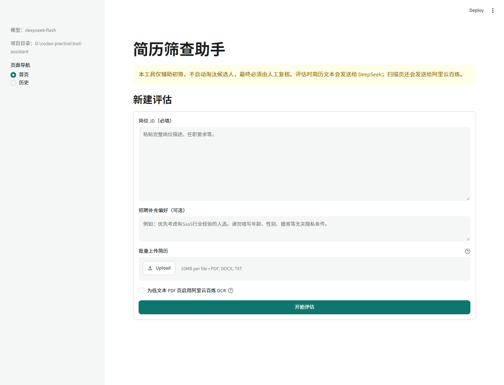
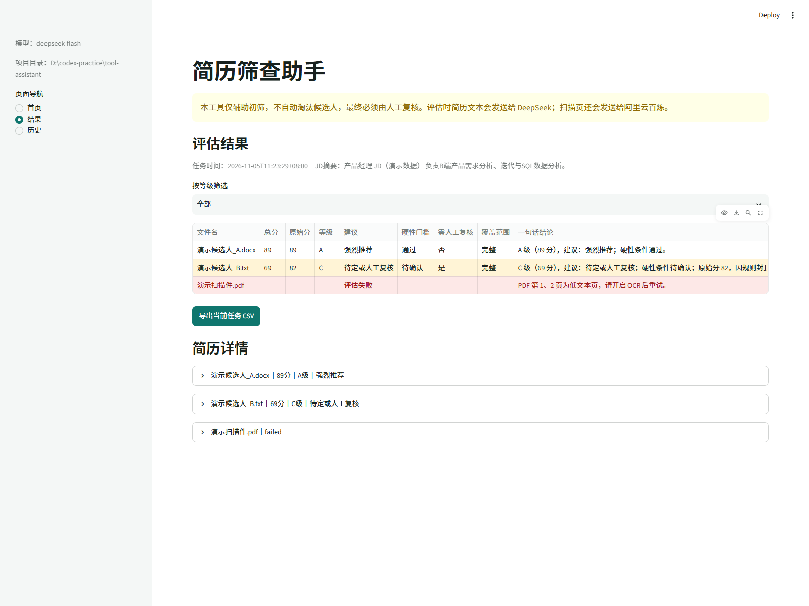

# 简历筛查助手

基于 JD 对简历进行辅助初筛的本地 Streamlit 工具。模型提取 JD 要求、候选人事实和证据，Python 规则判断硬性条件并计算可复现的 100 分制结果。

本工具仅辅助初筛，不自动淘汰候选人，最终必须由人工复核。



## 功能

- 批量解析 PDF、DOCX、TXT 简历。
- PDF 逐页判断，只对低文本页调用阿里云百炼 `qwen3.5-ocr`。
- DeepSeek `deepseek-flash` 提取事实和逐条匹配证据。
- Python 规则判断学历、年限和证书，硬条件待确认按 0 分计。
- 硬条件待确认或评估范围不完整时总分封顶 69 分并标记人工复核。
- 硬条件明确不满足时等级强制 D、总分封顶 54 分。
- 展示维度得分、原文证据、风险、待确认项和面试问题。
- SQLite 历史记录和 Excel 兼容 CSV 导出。

## 项目位置

代码、详细配置和自测清单位于 [`tool-assistant/`](tool-assistant/)。

完整文档：[tool-assistant/README.md](tool-assistant/README.md)

结果页示例：



## 快速启动

```powershell
cd tool-assistant
python -m venv .venv
.\.venv\Scripts\Activate.ps1
python -m pip install -r requirements.txt
Copy-Item .env.example .env
notepad .env
streamlit run app.py
```

所有新评估需要本地配置 `DEEPSEEK_API_KEY`。只有实际需要 OCR 时才需要 `DASHSCOPE_API_KEY`。

不要把 API Key 提交到仓库或发送到聊天中。`.env` 已被 Git 忽略。

## 测试

```powershell
cd tool-assistant
python -m pip install -r requirements-dev.txt
python -m pytest -q
```

当前测试结果：27 项通过。

## 隐私说明

网页和数据库在本机运行，但简历正文会发送给 DeepSeek；扫描页会发送给阿里云百炼。项目不保存原始简历文件，只保存 JD、前 2000 字预览和评估结果。使用前应确认组织已授权相关云服务处理简历数据。
