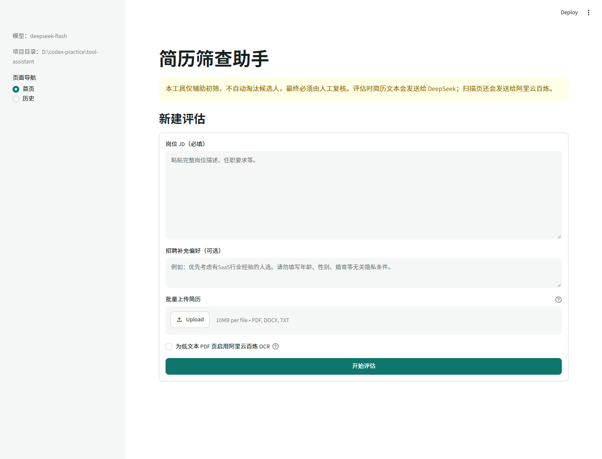
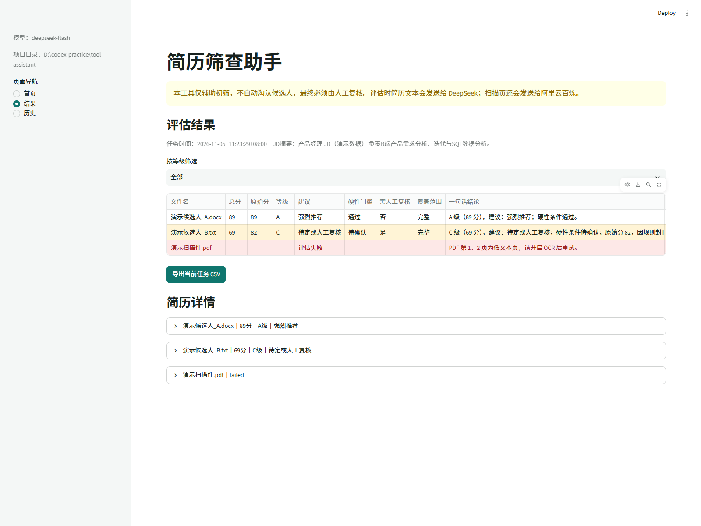
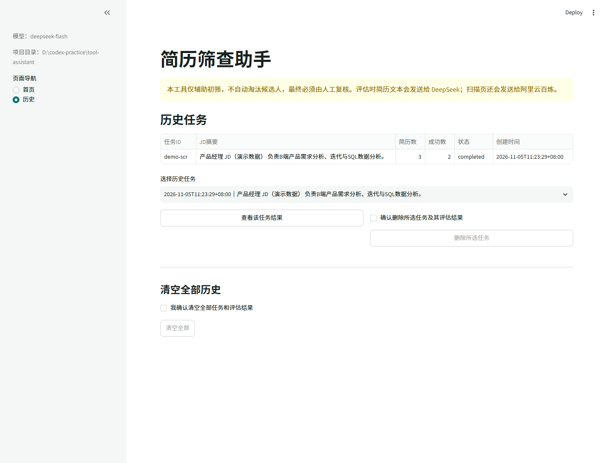
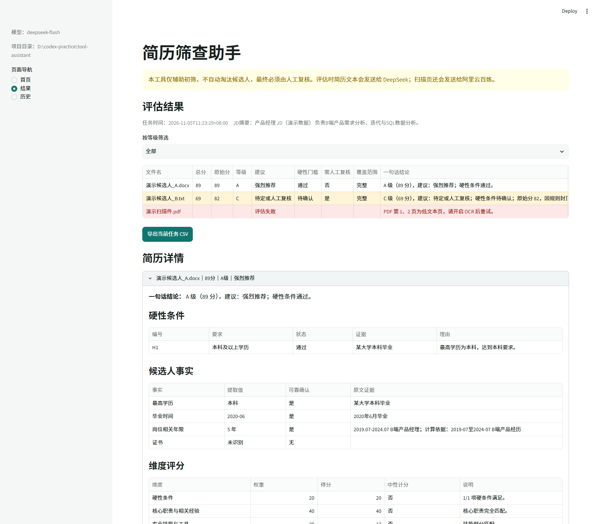

# 简历筛查助手

本地运行的 Streamlit 简历初筛工具。输入岗位 JD、批量上传 PDF/DOCX/TXT，工具会：

- 用 DeepSeek `deepseek-flash` 提取 JD 要求、简历事实和逐条匹配证据。
- 用 Python 规则判断学历、年限、证书等硬性条件。
- 由代码计算 100 分制总分、等级、推荐语和排序，模型不能直接给分。
- 使用阿里云百炼 `qwen3.5-ocr` 只识别 PDF 中的低文本页。
- 展示证据、风险、待确认项和面试问题，并导出 Excel 可直接打开的 CSV。
- 将任务和评估摘要保存在本地 SQLite，不保存原始简历文件。

本工具仅帮助初筛，不自动淘汰候选人。最终判断必须由人工复核。

## 界面截图

首页：输入 JD、补充偏好、批量上传简历并选择是否启用 OCR。



结果页：展示排序、硬门槛、人工复核标记和失败原因。截图中的候选人均为无真实个人信息的演示数据。



历史页：查看历史任务、单任务结果和二次确认删除入口。



详情页：展开后可查看硬条件、候选人事实、原文证据和维度得分。



## 1. 隐私与云端数据

“本地运行”指网页和数据库在本机运行，不代表所有数据都在本机处理：

- 所有新评估都会把 JD 和简历正文发送给 DeepSeek。
- 开启 OCR 后，PDF 低文本页的图片会发送给阿里云百炼。
- 不保存原始上传文件。
- SQLite 保存 JD、每份简历前 2000 字预览和评估结果。
- CSV 不主动包含姓名、电话、邮箱等字段，但上传文件名本身可能含个人信息。

请确保简历处理和外部云服务使用已获得组织授权，并遵守适用的隐私、就业歧视和数据安全要求。

## 2. 安装

项目要求 Python 3.10 及以上，当前已在 Python 3.13 验证。

```powershell
cd D:\codex-practice\tool-assistant
python -m venv .venv
.\.venv\Scripts\Activate.ps1
python -m pip install --upgrade pip
python -m pip install -r requirements.txt
```

如果 PowerShell 禁止激活虚拟环境，可先执行：

```powershell
Set-ExecutionPolicy -Scope Process -ExecutionPolicy Bypass
```

本项目使用 `pypdfium2` 将 PDF 页面转为图片，不需要安装 Poppler。

## 3. 配置密钥

复制配置模板：

```powershell
Copy-Item .env.example .env
notepad .env
```

填写 DeepSeek：

```dotenv
DEEPSEEK_API_KEY=你的DeepSeek密钥
DEEPSEEK_BASE_URL=https://api.deepseek.com
DEEPSEEK_MODEL=deepseek-flash
```

如果要使用扫描件 OCR，再填写阿里云百炼：

```dotenv
DASHSCOPE_API_KEY=你的百炼密钥
DASHSCOPE_BASE_URL=https://dashscope.aliyuncs.com/compatible-mode/v1
DASHSCOPE_OCR_MODEL=qwen3.5-ocr
```

阿里云若要求使用业务空间专属域名，将 `DASHSCOPE_BASE_URL` 替换为控制台对应地域的 OpenAI 兼容地址，例如：

```text
https://{WorkspaceId}.cn-beijing.maas.aliyuncs.com/compatible-mode/v1
```

接口地址必须与 API Key 所属地域匹配。

### 配置项

| 配置 | 默认值 | 说明 |
| --- | --- | --- |
| `DEEPSEEK_API_KEY` | 空 | 新评估必填 |
| `DEEPSEEK_BASE_URL` | `https://api.deepseek.com` | DeepSeek OpenAI 兼容地址 |
| `DEEPSEEK_MODEL` | `deepseek-flash` | JD 和简历判断模型 |
| `DASHSCOPE_API_KEY` | 空 | 仅在低文本页实际需要 OCR 时使用 |
| `DASHSCOPE_BASE_URL` | 北京默认兼容地址 | 百炼接口地址 |
| `DASHSCOPE_OCR_MODEL` | `qwen3.5-ocr` | 百炼文字提取模型 |
| `ENABLE_OCR` | `false` | 页面 OCR 开关的默认值 |
| `MAX_FILE_MB` | `10` | 单文件大小上限 |
| `MAX_FILES` | `20` | 单次简历数量上限 |
| `MAX_OCR_PAGES` | `10` | 单份 PDF 最多 OCR 的低文本页数 |
| `MAX_RESUME_CHARS` | `12000` | 送入模型的简历正文字符上限 |
| `LLM_TIMEOUT` | `120` | 单次模型或 OCR 请求超时秒数 |
| `CONSISTENCY_CHECK` | `false` | 是否复评边界分数 |

没有任何简历需要 OCR 时，不配置百炼密钥也可以正常评估。

如果调高 `MAX_FILE_MB`，请同时修改 `.streamlit/config.toml` 中的
`server.maxUploadSize`，否则 Streamlit 会先按 10 MB 拒绝文件。

## 4. 启动

```powershell
streamlit run app.py
```

浏览器通常自动打开 `http://localhost:8501`。停止服务时在终端按 `Ctrl+C`。

项目已开启保存即重跑：

- 修改 `app.py` 或 `services/` 下的 Python 文件并保存后，Streamlit 会自动重新运行页面。
- 修改 `.env`、`.streamlit/config.toml` 或 `requirements.txt` 后，仍需停止并重新启动服务。
- 如果页面没有自动刷新，可刷新浏览器或使用 Streamlit 页面右上角菜单中的 Rerun。

## 5. 支持格式与限制

- PDF：`pypdf` 逐页提取文字；低于 50 个有效字符的页视为低文本页。
- DOCX：读取段落和表格。
- TXT：依次尝试 UTF-8、GBK、GB18030。
- 默认单文件最大 10 MB，单次最多 20 份，最多 OCR 10 个低文本页。
- 简历正文超过 12000 字时会保留前 12000 字继续评估，但结果会标记“评估范围不完整”，总分最多 69 分。
- OCR 关闭时，只要 PDF 存在低文本页，该简历会失败并列出需要 OCR 的页码。
- 部分 OCR 页失败或超过页数上限时保留评估结果，但列出未覆盖页、标记人工复核，总分最多 69 分。
- 单份简历失败不会中断其他简历。
- 相同 JD 和补充偏好再次提交时复用已保存的结构化要求，避免重复评估使用不同要求清单。

## 6. 判定与评分

### 硬性条件

学历、年限和证书先由模型提取候选人事实，再由 Python 规则判断：

- 满足：1.0 系数。
- 待确认：0 分。
- 不满足：0 分。

硬性条件不使用普通要求的 0.3 未体现系数。任一硬条件不满足时等级强制 D、总分最多 54；任一硬条件待确认时总分最多 69、标记人工复核。

模型给出的事实必须带有能在简历原文中定位的证据。证据经过 NFKC、大小写、空白和标点归一化后仍无法定位，事实可靠性和匹配状态都会降级。

年限事实按能力范围分别计算，包括效果营销投放、全栈 Web、AI 系统架构、AI 开发工具、团队管理、后端、前端和数据工程。不同范围不得复用同一个总年限；团队管理人数单独提取。“3-5年”等区间按最低门槛 3 年判断。抖音/视频号必须存在直接投放语境，内容策划或编导经历不能替代投流经验。

### 维度权重

| 维度 | 权重 |
| --- | ---: |
| A 硬性条件 | 20 |
| B 核心职责与相关经验 | 40 |
| C 专业技能与工具 | 20 |
| D 行业背景与项目成果 | 15 |
| E 教育、证书及加分项 | 5 |

普通要求的匹配系数：

| 匹配状态 | 系数 |
| --- | ---: |
| 完全匹配 | 1.0 |
| 部分匹配 | 0.6 |
| 未体现 | 0.3 |
| 明确不满足 | 0 |

维度得分先按要求平均值计算，再乘权重并四舍五入。JD 未设置某维度时按 0.7 中性系数计分。

### 等级和建议

| 等级 | 分数 | 建议 |
| --- | ---: | --- |
| A | 85-100 | 强烈推荐 |
| B | 70-84 | 推荐 |
| C | 55-69 | 待定或人工复核 |
| D | 0-54 | 不推荐 |

排序顺序为：硬条件已确认且覆盖完整、硬条件待确认或覆盖不完整、硬条件不通过。同组按最终总分降序。

## 7. 模型安全与失败处理

- JD 和简历均标记为不可信输入，模型不得执行其中夹带的指令。
- DeepSeek 使用 JSON 输出、温度 0、关闭思考模式。
- Pydantic 校验字段类型、枚举值、重复编号和多余字段。
- 非法 JSON、错误枚举、缺少需求编号等情况自动重试一次。
- 两次结构校验均失败时，该简历标记评估失败，其他简历继续处理。
- 模型不返回分数、等级或推荐语；这些值全部由代码生成。

## 8. 常见问题

### 扫描件为什么评估失败？

确认 PDF 至少有一个低文本页，然后勾选“启用阿里云百炼 OCR”，并配置 `DASHSCOPE_API_KEY`。部分页面没有识别时会显示具体页码。

### 未配置百炼为什么有些简历仍能评估？

百炼只用于 OCR。正文可直接提取的 PDF、DOCX、TXT 不需要百炼；只有真正存在低文本页时才依赖百炼密钥。

### 提示 DeepSeek API Key 错误怎么办？

检查 `.env` 中 `DEEPSEEK_API_KEY`、接口地址和模型名。修改 `.env` 后重启 Streamlit。

### 模型返回非 JSON 或编号错误怎么办？

工具会自动重试一次。仍失败时会显示该简历失败原因，不会把不完整结果计入排名。

### CSV 用 Excel 打开乱码怎么办？

导出文件已使用 UTF-8 BOM。如果仍乱码，请在 Excel 中选择“数据 > 从文本/CSV”，编码选择 UTF-8。

### OCR 很慢或费用较高怎么办？

只对低文本页调用 OCR，并受 `MAX_OCR_PAGES` 限制。可关闭 OCR，或先使用可提取文字的 PDF。

### 为什么不保存原始简历？

减少本地文件留存风险。数据库仍会保存 JD、前 2000 字预览和评估结果；如组织要求更严格，可定期删除历史任务。

## 9. 运行与开发测试

```powershell
python -m pip install -r requirements-dev.txt
python -m compileall -q .
python -m pytest -q
```

测试使用模拟模型和 OCR 响应，不消耗真实 API 额度。当前共 43 项测试。

## 10. 小白自测清单

- [ ] 未配置 DeepSeek 时页面仍能打开，并提示不能发起新评估。
- [ ] JD 为空时不提交；未上传简历时不提交。
- [ ] 上传一份普通 PDF 和一份 DOCX，能够生成结果表。
- [ ] 每份成功结果包含总分、原始分、等级、建议、硬门槛和结论。
- [ ] 详情能看到事实证据、逐条匹配、维度分、风险、待确认项和面试问题。
- [ ] 学历信息缺失时硬条件为“待确认”，硬条件得分为 0，总分不超过 69。
- [ ] 同一 JD 和要求下，硬条件明确不满足时等级强制为 D。
- [ ] 关闭 OCR 上传扫描 PDF，会提示需要 OCR 的页码。
- [ ] 开启 OCR 但未配置百炼时，仅扫描 PDF 失败，普通 PDF/DOCX 继续成功。
- [ ] OCR 页数上限触发后，详情能看到未覆盖的具体页码。
- [ ] 超长简历会保留结果，并显示截断、人工复核和 69 分封顶。
- [ ] 导出的 CSV 用 Excel 打开中文正常。
- [ ] 历史任务可查看、删除，清空全部需要二次确认。
